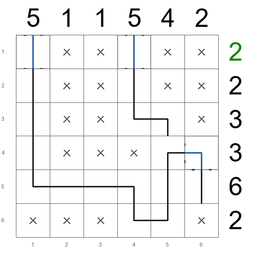
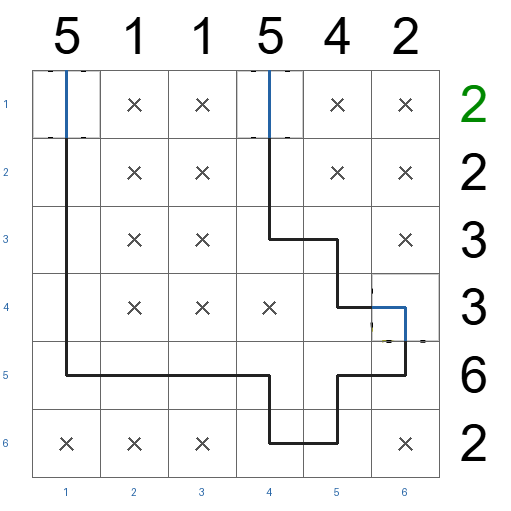
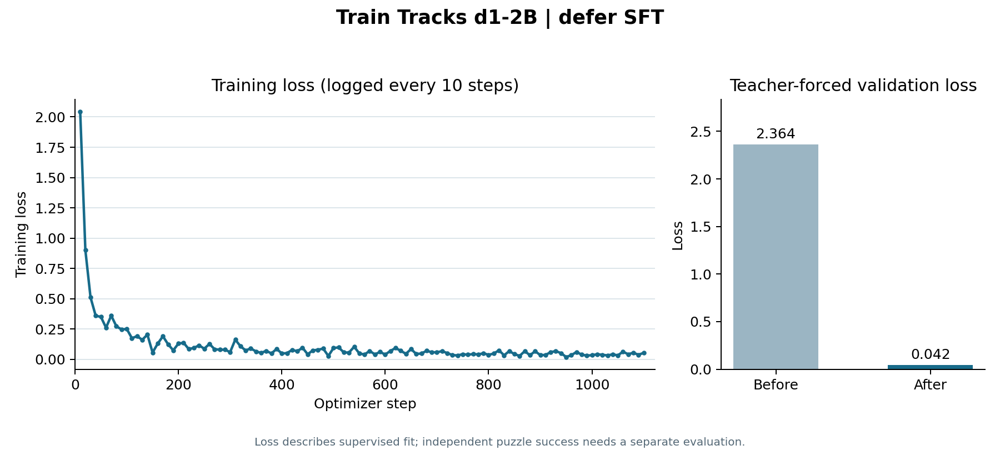
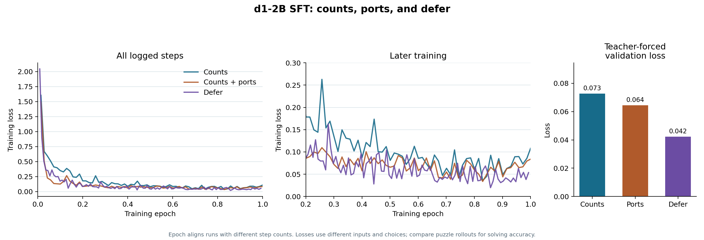

# Train Tracks LiquidAI/d1-2B experiment report

**Status:** archived after validation. The experiment is complete; no held-out
test split was used. The best whole-puzzle result was **4/46** on validation
with counts and ports. The defer variant improved individual cell accuracy but
solved **0/46** whole puzzles.

The model was `LiquidAI/d1-2B`, fine-tuned to choose track tiles from puzzle
images. Each evaluation replayed the model's own previous choices and scored
the complete board against a verified unique solution. The existing solver did
not choose or repair moves during evaluation.

## Validation outcome

| Measure | [Counts](modal/docs/COUNTS_VALIDATION.md) | [Counts + ports](modal/docs/PORTS_VALIDATION.md) | [Defer](modal/docs/DEFER_VALIDATION.md) |
| --- | ---: | ---: | ---: |
| Whole puzzles solved | 3/46 | **4/46** | 0/46 |
| Correct cells | 1,511/2,472 (61.1%) | 1,401/2,472 (56.7%) | **1,540/2,472 (62.3%)** |
| Exact track shapes | 333/1,067 | 372/1,067 | **399/1,067** |
| Model decisions | 2,472 | 2,472 | 4,231 |
| Deferrals | 0 | 0 | 1,852 |
| Unresolved cells | 0 | 0 | 93 |
| Boards with broken ports | 42/46 | **25/46** | 42/46 |

Defer delayed uncertain cells but spent many extra decisions. Ten puzzles hit
the decision cap with cells still unresolved; the other 36 completed with at
least one wrong tile. The [full side-by-side gallery can be regenerated](modal/docs/GALLERIES.md)
from the saved validation report.

| Defer prediction: `19012026-small` (30/33 cells) | Verified solution |
| --- | --- |
|  |  |

## Training curves

## Three-run comparison

| Measure | [Counts](modal/docs/COUNTS_FULL_TRAINING.md) | [Counts + ports](modal/docs/PORTS_FULL_TRAINING.md) | Defer |
| --- | ---: | ---: | ---: |
| Training puzzles | 212 | 212 | 212 |
| Training cells | 11,187 | 11,187 | 11,187 |
| Training decisions | 11,187 | 11,187 | 17,728 |
| Teacher deferrals | 0 | 0 | 6,541 |
| Validation decisions | 2,472 | 2,472 | 3,824 |
| Optimizer steps | 700 | 700 | 1,108 |
| Training time | 29.6 min | 31.3 min | 60.3 min |
| Peak allocated GPU memory | 5.84 GiB | 5.91 GiB | 6.02 GiB |
| Mean training loss | 0.1719 | 0.1123 | 0.1135 |
| Teacher-forced validation loss, before | 2.0739 | 1.8885 | 2.3638 |
| Teacher-forced validation loss, after | 0.0727 | 0.0644 | 0.0422 |
| Whole-puzzle validation | 3/46 | 4/46 | 0/46 |

All three runs used the same base setup:

- **Model:** `LiquidAI/d1-2B` at revision `97c57047d5852d77e02dfac211f8768aff77a8b2`.
- **Dataset:** `zuhairsan/train-tracks-decisions` at revision `bfddb2300d31281c305c13b72432c081f33b72c6`.
- **Training:** one epoch, batch size 2, eight gradient accumulation steps, and seed 42.
- **LoRA:** rank 16, alpha 32, dropout 0.05, and learning rate `2e-4`.
- **Defer variant:** its queue trajectories added examples and optimizer steps, plus an eighth choice.

The chart aligns the runs by epoch. Their input states and choices differ, so
**training loss does not compare puzzle-solving ability**. The 46-puzzle
validation results above show that outcome.

## Artifacts

- [Defer loss data](modal/training-logs/defer-full-sft-loss.csv)
- [Defer validation analysis](modal/docs/DEFER_VALIDATION.md)
- [Modal code and usage](modal/README.md)

The defer checkpoint remains in the `train-tracks-d1-training` Modal Volume at
`runs/d1-2b-defer-full-train-tracks-decisions-20261111T194102Z`.
