# How to play

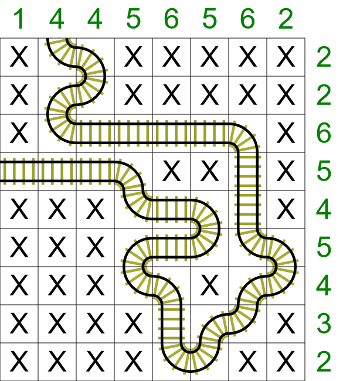

This is an example of a completed TrainTracks puzzle. The puzzle starts with two entrance/exit pieces of tracks, and these will be 'pointing' to the edge of the puzzle. The aim is to fill in the rest of the puzzle with one continuous piece of track so that all the clues are satisfied.
There are horizontal and vertical clues, and these tell you how many pieces of track appear in that row or column. For example, we can see that the first row has a clue of '2', and we can see there are two pieces of track in this row.

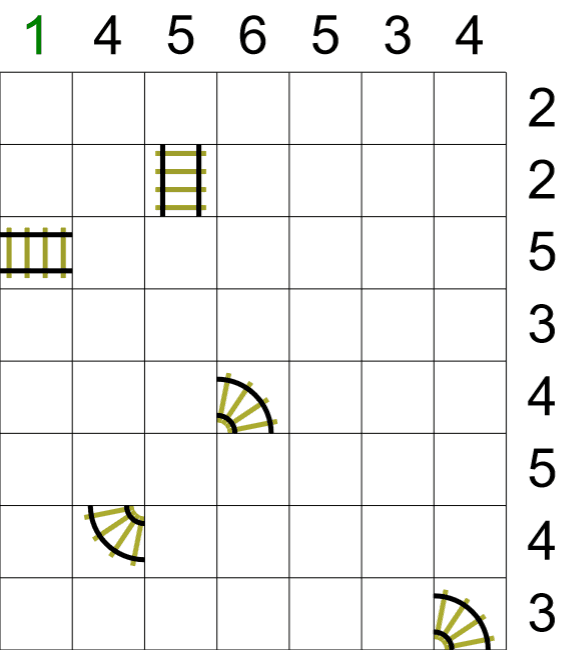

This is an example starting grid. We have been given some starting pieces of track, but most are missing.
The first task on any TrainTacks puzzle is to look for rows and columns that are already complete, i.e. where the clue is satisfied. If we look at the first column from the left, we can see that clue is '1', so we can fill the rest of the cells in that column with a 'X'.
The second task for this puzzle is to mark all the implied cells. These are cells where there is a piece of track that 'points' to that cell. We don't know exactly which piece of track will be in these cells, but we know they will contain a piece of track, so we can mark them as being occupied.

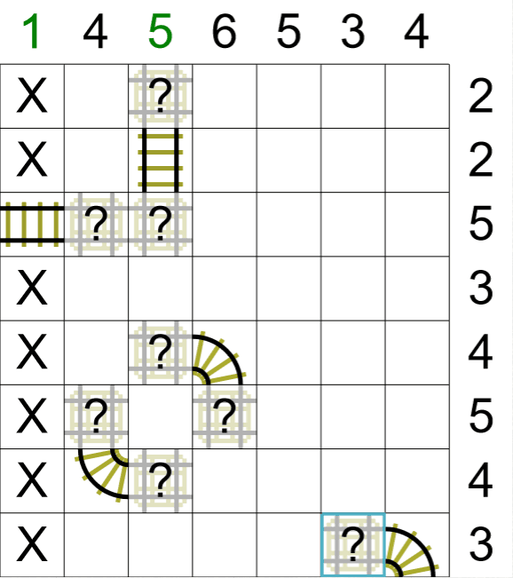

We can now see that the third column from the left has it's requirement of five pieces of track, so we can insert a 'X' for all the remaining cells in this column.

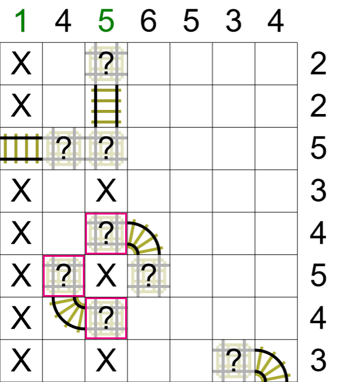

We can now fill in the three highlighted cells. Looking at the top-most highlighted cell, we can see that the track can't turn up or down, so this must be a horizontal piece of track. We can apply the same argument to the other two highlighted cells.

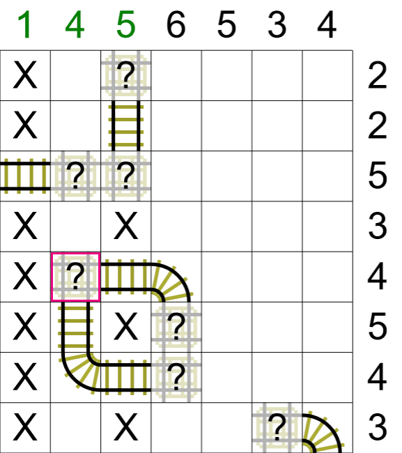

We can now fill in the highlighted cell - we have two tracks leading in to this cell, so there is only one possibility for this cell.
You will also notice that we have the required four pieces of track for this column, so we can also fill in a 'X' for this column.

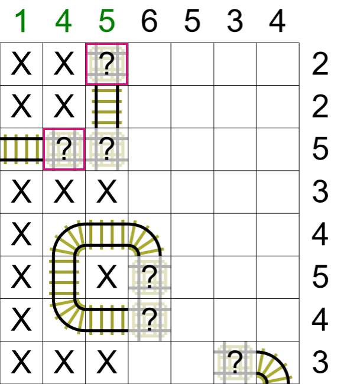

We can now fill in a total of three cells. Let's start with the the highlighted cell in the second column - this has to be a horizontal piece of track as we know the cells above/below are empty. This also means the cell directly to it's right (not highlighted) must be a piece of track curving upwards.
We can also fill in the highlighted cell in the third column. This piece of track now has nowhere to go, so this piece of track must curve to the right.

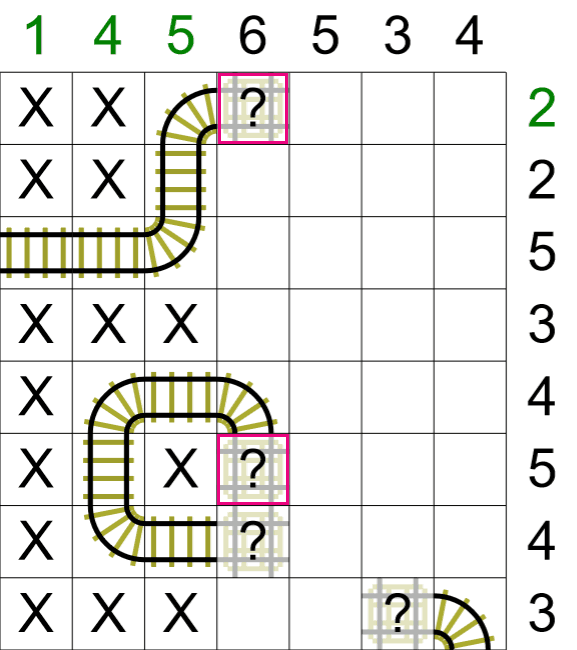

Let's now look at the two highlighted cells. You will notice that the top row now has it's required two pieces of track. This means that this highlighted cell must curve downwards.
Let's also look at the lower highlighted cell. There are two options for this cell, either a vertical straight piece, or a piece of track curving to the right. If this cell was a straight vertical piece of track, then that would mean the cell under it must curve round to the left, i.e. creating a closed loop. This must mean the highlighted cell must curve to the right.

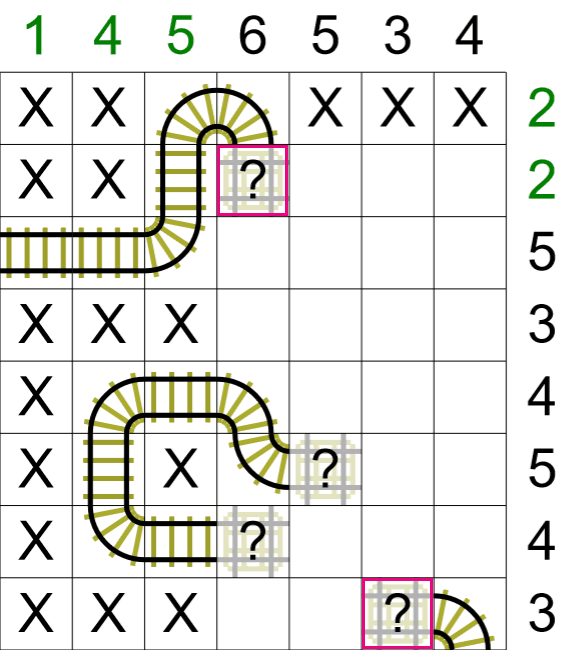

We can now look at the two highlighted cells. You will notice that the second row down has it's required two pieces of track, so this highlighted cell must be a straight vertical piece of track.
We can also look at the highlighted cell on the bottom row. There are two possibilities for this cell, either a horizontal straight piece, or a track piece that curves upwards. If this cell contained a track piece that curved upwards, then this row would need one more track piece to satisfy the '3' clue for this row. There is no way to satisfy this requirement as the track would need one piece to enter this row, and another piece to leave, i.e. a U combination.
This would give four track sections instead of the required 3.
This means the bottom highlighted piece of track must be a horizontal straight piece of track (and the track piece to it's left must curve upwards).

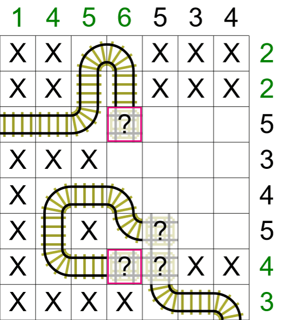

We can now fill in the two highlighted cells. The lower highlighted cell can only be a horizontal piece of track (and the cell to the right must curve downwards).
We can apply the same logic from the last step to the upper highlighted cell. We can see that this row already has four out of the five required sections of tracks. The only way this row can be completed is if the highlighted curves to the right, (and the cell to it's right curves downwards).
This also means that with the implied cells, the third column from the right with the '5' clue has it's required number of track pieces. We can insert a 'X' for the remaining cells in this column.

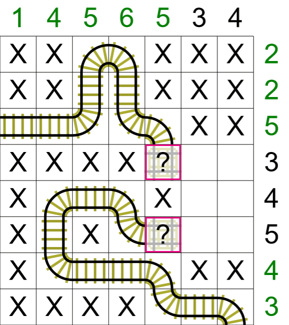

We can now fill in the two highlighted cells - there is only one possibility for these two cells!

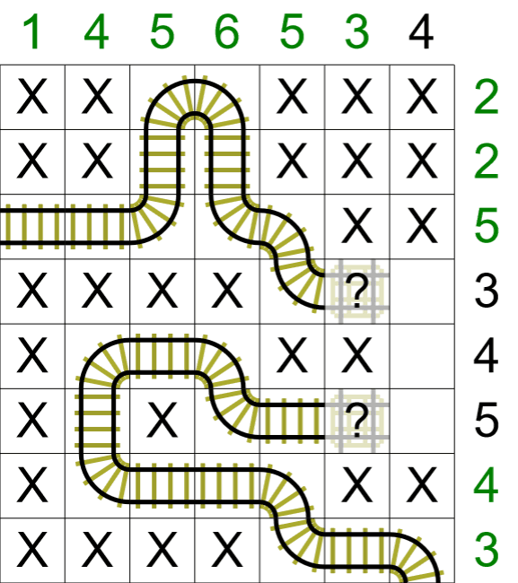

We have now arrived at this position, and there is now only one way to complete this puzzle!

