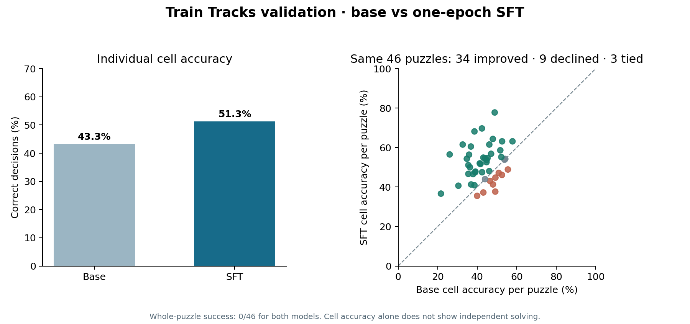
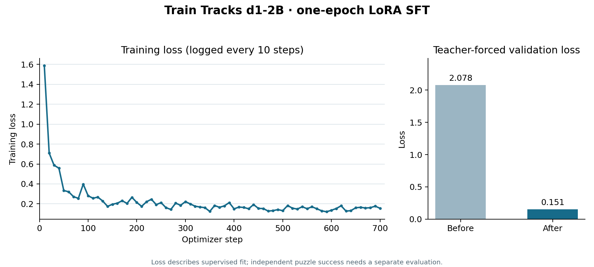

# Base versus SFT d1-2B validation evaluation

- Run: https://modal.com/apps/zuhairsannnnn/main/ap-OKbEWXliEZ0dbxxn6WUHql
- Report: `zuhairsan/train-tracks-decisions` / `validation`; Modal Volume `train-tracks-d1-training/rollouts/validation-base-20261110T181118Z.json`
- Model: `LiquidAI/d1-2B` at `97c57047d5852d77e02dfac211f8768aff77a8b2`
- Dataset revision: `bfddb2300d31281c305c13b72432c081f33b72c6`

## Results

| Measure | Base d1-2B | One-epoch SFT | Change |
| --- | ---: | ---: | ---: |
| Whole puzzles solved | **0/46** | **0/46** | 0 |
| Correct cell decisions on independent rollouts | 1,070/2,472 (43.3%) | 1,269/2,472 (51.3%) | **+199 cells; +8.1 percentage points** |
| Malformed answers | 0/2,472 | 0/2,472 | 0 |
| Sum of per-puzzle inference time | 85.0 s | 85.9 s | +0.9 s |

SFT improved cell accuracy on **34 puzzles**, declined on **9**, and tied on **3**. It did not improve whole-puzzle success in this validation set. Inference times exclude model loading and dataset download.

### Row and column clue audit

Every completed validation board from both models violated at least one row clue and at least one column clue. The mean absolute error per clue fell from **1.81 to 1.75** for rows and from **2.21 to 1.84** for columns after SFT. These counts were checked against the audited puzzle records using `modal/tools/analyze_constraints.py`. The SFT model learned some individual placements but has not learned to preserve the global clue totals across its own sequence of moves.

[Per-puzzle comparison CSV](../training-logs/validation-comparison.csv)

## Method

The unmodified and fine-tuned d1-2B completed the same 46 validation puzzles in row-major order. At each step each model saw the current board image and its own earlier actions. There were no retries, solver corrections, or filtered choices. After the last move, all unknown-cell choices were compared with the verified unique solution. For this audited dataset, a full exact match is equivalent to the verified whole-puzzle solution. The checker was not called during either evaluation.

[Recreate the 46-puzzle visual gallery](GALLERIES.md)

## Full SFT training run

- Run: https://modal.com/apps/zuhairsannnnn/main/ap-CGsIFkiGh7EODvKVnb9Yge
- Run ID: `d1-2b-full-train-tracks-decisions-20261110T182530Z`
- Data: 11,187 training decisions; 2,472 validation decisions; dataset revision `bfddb2300d31281c305c13b72432c081f33b72c6` (the same revision as the base evaluation).
- Recipe: one epoch, 700 optimizer steps, LoRA rank 16 / alpha 32 / dropout 0.05, learning rate 2e-4, batch size 2 with 8 accumulation steps, seed 42.
- Training time: **1,625.7 seconds (27.1 minutes)**; peak allocated GPU memory: **5.72 GiB**.
- Teacher-forced validation loss: **2.078 before → 0.151 after**. This measures supervised fit, not independent puzzle completion.

The graph uses all 70 logged training-loss points (one every 10 optimizer steps). The extracted values are in [full-sft-loss.csv](../training-logs/full-sft-loss.csv). The independent evaluation below measures puzzle completion separately from training loss.

## Fine-tuned validation run

- Run: https://modal.com/apps/zuhairsannnnn/main/ap-wIn3UcjWWTXh72ETmapNuw
- Report: `train-tracks-d1-training/rollouts/validation-sft-d1-2b-full-train-tracks-decisions-20261110T182530Z-20261110T232946Z.json`
- Checkpoint: `d1-2b-full-train-tracks-decisions-20261110T182530Z`
- Dataset revision: `bfddb2300d31281c305c13b72432c081f33b72c6`, matching the base evaluation.

[Recreate the fine-tuned 46-puzzle visual gallery](GALLERIES.md)

## Per-puzzle base results

| Puzzle | Solved | Correct cells | Cell accuracy | Seconds |
| --- | --- | ---: | ---: | ---: |
| 01012026-small | No | 30/61 | 49.2% | 5.57 |
| 04012026-small | No | 22/45 | 48.9% | 1.36 |
| 06012026-small | No | 30/58 | 51.7% | 1.83 |
| 08012026-small | No | 17/52 | 32.7% | 1.66 |
| 13012026-small | No | 18/59 | 30.5% | 2.12 |
| 19012026-small | No | 14/33 | 42.4% | 0.89 |
| 04022026-small | No | 16/44 | 36.4% | 1.34 |
| 13022026-small | No | 18/46 | 39.1% | 1.45 |
| 19022026-small | No | 18/39 | 46.2% | 1.15 |
| 20022026-small | No | 34/76 | 44.7% | 2.73 |
| 25022026-small | No | 24/51 | 47.1% | 1.62 |
| 05032026-small | No | 17/40 | 42.5% | 1.13 |
| 12032026-small | No | 35/67 | 52.2% | 2.35 |
| 15032026-small | No | 30/67 | 44.8% | 2.24 |
| 19032026-small | No | 17/44 | 38.6% | 1.29 |
| 22032026-small | No | 18/45 | 40.0% | 1.30 |
| 24032026-small | No | 16/45 | 35.6% | 1.31 |
| 09042026-small | No | 31/75 | 41.3% | 2.70 |
| 23042026-small | No | 13/60 | 21.7% | 1.99 |
| 26042026-small | No | 25/60 | 41.7% | 2.13 |
| 29042026-small | No | 22/51 | 43.1% | 1.50 |
| 30042026-small | No | 28/76 | 36.8% | 2.73 |
| 08052026-small | No | 29/66 | 43.9% | 2.34 |
| 20052026-small | No | 36/75 | 48.0% | 2.71 |
| 31052026-small | No | 24/52 | 46.2% | 1.74 |
| 01062026-small | No | 32/59 | 54.2% | 1.98 |
| 09062026-small | No | 17/46 | 37.0% | 1.47 |
| 12062026-small | No | 27/53 | 50.9% | 1.74 |
| 26062026-small | No | 25/45 | 55.6% | 1.40 |
| 27062026-small | No | 22/50 | 44.0% | 1.61 |
| 01072026-small | No | 21/39 | 53.8% | 1.17 |
| 09072026-small | No | 33/67 | 49.3% | 2.37 |
| 12072026-small | No | 16/45 | 35.6% | 1.38 |
| 14072026-small | No | 20/38 | 52.6% | 1.12 |
| 22072026-small | No | 12/46 | 26.1% | 1.48 |
| 24072026-small | No | 27/58 | 46.6% | 1.89 |
| 01082026-small | No | 16/46 | 34.8% | 1.47 |
| 10082026-small | No | 24/53 | 45.3% | 1.84 |
| 13082026-small | No | 22/51 | 43.1% | 1.70 |
| 14082026-small | No | 35/73 | 47.9% | 2.73 |
| 17082026-small | No | 22/38 | 57.9% | 1.12 |
| 10092026-small | No | 23/59 | 39.0% | 2.14 |
| 28092026-small | No | 22/58 | 37.9% | 1.79 |
| 02102026-small | No | 14/39 | 35.9% | 1.12 |
| 18102026-small | No | 17/44 | 38.6% | 1.35 |
| 28102026-small | No | 41/78 | 52.6% | 2.93 |
