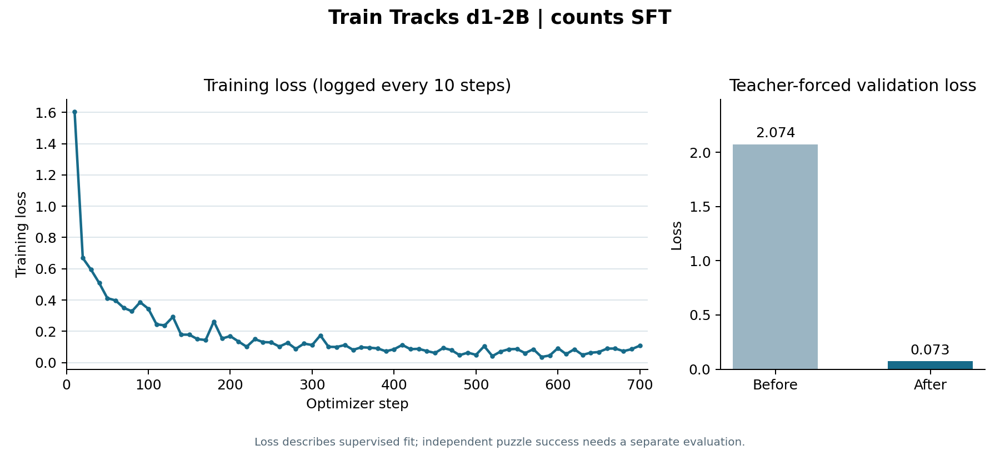

# Counts SFT: full training run

**Run:** [`d1-2b-counts-full-train-tracks-decisions-20261111T035117Z`](https://modal.com/apps/zuhairsannnnn/main/ap-usgbPPtlhUwFPTsfM3q6VK)  
**Status:** completed; checkpoint saved in the Modal Volume.



| Measure | Value |
| --- | ---: |
| Training decisions | 11,187 |
| Validation decisions | 2,472 |
| Optimizer steps | 700 |
| Training time | 29.6 minutes |
| Peak allocated GPU memory | 5.84 GiB |
| Mean training loss | 0.1719 |
| Teacher-forced validation loss, before | 2.0739 |
| Teacher-forced validation loss, after | 0.0727 |

The loss graph contains every logged training point, one per 10 optimizer steps.
The fall in teacher-forced validation loss shows fit to the verified decision
states. It does not measure independent whole-puzzle solving. That requires a
separate model-owned rollout on the 46 validation puzzles.

Model: `LiquidAI/d1-2B` at revision `97c57047d5852d77e02dfac211f8768aff77a8b2`. Dataset:
`zuhairsan/train-tracks-decisions` at revision `bfddb2300d31281c305c13b72432c081f33b72c6`. Recipe:
one epoch, LoRA rank 16 / alpha 32 / dropout 0.05, learning rate 2e-4, batch
size 2 with 8 accumulation steps, seed 42. The visual variant is `counts`.
The checkpoint is at `/mnt/train-tracks-d1-training/runs/d1-2b-counts-full-train-tracks-decisions-20261111T035117Z` in the Modal Volume.

[Plot data as CSV](../training-logs/counts-full-sft-loss.csv)

## Full training log

```text
Training LiquidAI/d1-2B: d1-2b-counts-full-train-tracks-decisions-20261111T035117Z
{'loss': '1.605', 'grad_norm': '2.558', 'learning_rate': '5.143e-05', 'entropy': '4.414', 'mean_token_accuracy': '0.6281', 'num_tokens': '2.268e+05', 'epoch': '0.0143'}
{'loss': '0.6685', 'grad_norm': '1.361', 'learning_rate': '0.0001086', 'entropy': '0.9265', 'mean_token_accuracy': '0.7875', 'num_tokens': '4.484e+05', 'epoch': '0.0286'}
{'loss': '0.5945', 'grad_norm': '2.788', 'learning_rate': '0.0001657', 'entropy': '0.5728', 'mean_token_accuracy': '0.7594', 'num_tokens': '6.741e+05', 'epoch': '0.0429'}
{'loss': '0.5091', 'grad_norm': '2.301', 'learning_rate': '0.0002', 'entropy': '0.4219', 'mean_token_accuracy': '0.8063', 'num_tokens': '9.03e+05', 'epoch': '0.0572'}
{'loss': '0.4117', 'grad_norm': '4.396', 'learning_rate': '0.0001998', 'entropy': '0.3773', 'mean_token_accuracy': '0.8469', 'num_tokens': '1.132e+06', 'epoch': '0.07151'}
{'loss': '0.3973', 'grad_norm': '1.681', 'learning_rate': '0.0001994', 'entropy': '0.4567', 'mean_token_accuracy': '0.85', 'num_tokens': '1.362e+06', 'epoch': '0.08581'}
{'loss': '0.3498', 'grad_norm': '3.881', 'learning_rate': '0.0001987', 'entropy': '0.3604', 'mean_token_accuracy': '0.8469', 'num_tokens': '1.593e+06', 'epoch': '0.1001'}
{'loss': '0.3279', 'grad_norm': '3.855', 'learning_rate': '0.0001978', 'entropy': '0.2888', 'mean_token_accuracy': '0.875', 'num_tokens': '1.82e+06', 'epoch': '0.1144'}
{'loss': '0.3859', 'grad_norm': '1.996', 'learning_rate': '0.0001968', 'entropy': '0.3055', 'mean_token_accuracy': '0.85', 'num_tokens': '2.046e+06', 'epoch': '0.1287'}
{'loss': '0.3441', 'grad_norm': '10.2', 'learning_rate': '0.0001955', 'entropy': '0.3381', 'mean_token_accuracy': '0.8562', 'num_tokens': '2.273e+06', 'epoch': '0.143'}
{'loss': '0.2445', 'grad_norm': '3.882', 'learning_rate': '0.000194', 'entropy': '0.225', 'mean_token_accuracy': '0.8812', 'num_tokens': '2.508e+06', 'epoch': '0.1573'}
{'loss': '0.2377', 'grad_norm': '2.47', 'learning_rate': '0.0001922', 'entropy': '0.2394', 'mean_token_accuracy': '0.8938', 'num_tokens': '2.732e+06', 'epoch': '0.1716'}
{'loss': '0.292', 'grad_norm': '5.886', 'learning_rate': '0.0001903', 'entropy': '0.1938', 'mean_token_accuracy': '0.8938', 'num_tokens': '2.957e+06', 'epoch': '0.1859'}
{'loss': '0.1785', 'grad_norm': '2.618', 'learning_rate': '0.0001882', 'entropy': '0.1812', 'mean_token_accuracy': '0.9219', 'num_tokens': '3.188e+06', 'epoch': '0.2002'}
{'loss': '0.1783', 'grad_norm': '1.404', 'learning_rate': '0.0001858', 'entropy': '0.1748', 'mean_token_accuracy': '0.925', 'num_tokens': '3.417e+06', 'epoch': '0.2145'}
{'loss': '0.1496', 'grad_norm': '3.436', 'learning_rate': '0.0001833', 'entropy': '0.1404', 'mean_token_accuracy': '0.95', 'num_tokens': '3.651e+06', 'epoch': '0.2288'}
{'loss': '0.1442', 'grad_norm': '2.307', 'learning_rate': '0.0001806', 'entropy': '0.1403', 'mean_token_accuracy': '0.9469', 'num_tokens': '3.873e+06', 'epoch': '0.2431'}
{'loss': '0.263', 'grad_norm': '3.096', 'learning_rate': '0.0001777', 'entropy': '0.168', 'mean_token_accuracy': '0.9031', 'num_tokens': '4.096e+06', 'epoch': '0.2574'}
{'loss': '0.1538', 'grad_norm': '1.154', 'learning_rate': '0.0001747', 'entropy': '0.212', 'mean_token_accuracy': '0.9313', 'num_tokens': '4.316e+06', 'epoch': '0.2717'}
{'loss': '0.1691', 'grad_norm': '4.789', 'learning_rate': '0.0001715', 'entropy': '0.09059', 'mean_token_accuracy': '0.9406', 'num_tokens': '4.549e+06', 'epoch': '0.286'}
{'loss': '0.1348', 'grad_norm': '1.1', 'learning_rate': '0.0001681', 'entropy': '0.1329', 'mean_token_accuracy': '0.9469', 'num_tokens': '4.769e+06', 'epoch': '0.3003'}
{'loss': '0.1011', 'grad_norm': '1.388', 'learning_rate': '0.0001645', 'entropy': '0.09938', 'mean_token_accuracy': '0.9469', 'num_tokens': '4.997e+06', 'epoch': '0.3146'}
{'loss': '0.1496', 'grad_norm': '6.525', 'learning_rate': '0.0001609', 'entropy': '0.1049', 'mean_token_accuracy': '0.9406', 'num_tokens': '5.227e+06', 'epoch': '0.3289'}
{'loss': '0.1309', 'grad_norm': '0.9264', 'learning_rate': '0.000157', 'entropy': '0.123', 'mean_token_accuracy': '0.9313', 'num_tokens': '5.446e+06', 'epoch': '0.3432'}
{'loss': '0.1287', 'grad_norm': '9.401', 'learning_rate': '0.0001531', 'entropy': '0.1324', 'mean_token_accuracy': '0.9406', 'num_tokens': '5.671e+06', 'epoch': '0.3575'}
{'loss': '0.1021', 'grad_norm': '1.496', 'learning_rate': '0.000149', 'entropy': '0.08784', 'mean_token_accuracy': '0.9469', 'num_tokens': '5.901e+06', 'epoch': '0.3718'}
{'loss': '0.1263', 'grad_norm': '1.153', 'learning_rate': '0.0001449', 'entropy': '0.08276', 'mean_token_accuracy': '0.95', 'num_tokens': '6.13e+06', 'epoch': '0.3861'}
{'loss': '0.08756', 'grad_norm': '0.3448', 'learning_rate': '0.0001406', 'entropy': '0.1246', 'mean_token_accuracy': '0.95', 'num_tokens': '6.354e+06', 'epoch': '0.4004'}
{'loss': '0.1212', 'grad_norm': '0.7182', 'learning_rate': '0.0001362', 'entropy': '0.09753', 'mean_token_accuracy': '0.9406', 'num_tokens': '6.583e+06', 'epoch': '0.4147'}
{'loss': '0.112', 'grad_norm': '3.225', 'learning_rate': '0.0001318', 'entropy': '0.09528', 'mean_token_accuracy': '0.9375', 'num_tokens': '6.805e+06', 'epoch': '0.429'}
{'loss': '0.1736', 'grad_norm': '22.62', 'learning_rate': '0.0001273', 'entropy': '0.1273', 'mean_token_accuracy': '0.9062', 'num_tokens': '7.028e+06', 'epoch': '0.4433'}
{'loss': '0.1005', 'grad_norm': '1.218', 'learning_rate': '0.0001227', 'entropy': '0.1014', 'mean_token_accuracy': '0.95', 'num_tokens': '7.262e+06', 'epoch': '0.4576'}
{'loss': '0.09958', 'grad_norm': '0.8277', 'learning_rate': '0.0001181', 'entropy': '0.09424', 'mean_token_accuracy': '0.9563', 'num_tokens': '7.488e+06', 'epoch': '0.4719'}
{'loss': '0.112', 'grad_norm': '0.8195', 'learning_rate': '0.0001134', 'entropy': '0.1083', 'mean_token_accuracy': '0.9437', 'num_tokens': '7.706e+06', 'epoch': '0.4862'}
{'loss': '0.08103', 'grad_norm': '1.406', 'learning_rate': '0.0001087', 'entropy': '0.05731', 'mean_token_accuracy': '0.9719', 'num_tokens': '7.929e+06', 'epoch': '0.5005'}
{'loss': '0.0976', 'grad_norm': '0.5952', 'learning_rate': '0.000104', 'entropy': '0.0759', 'mean_token_accuracy': '0.9563', 'num_tokens': '8.161e+06', 'epoch': '0.5148'}
{'loss': '0.09497', 'grad_norm': '1.075', 'learning_rate': '9.929e-05', 'entropy': '0.1049', 'mean_token_accuracy': '0.9563', 'num_tokens': '8.393e+06', 'epoch': '0.5291'}
{'loss': '0.09038', 'grad_norm': '2.068', 'learning_rate': '9.457e-05', 'entropy': '0.07562', 'mean_token_accuracy': '0.9531', 'num_tokens': '8.626e+06', 'epoch': '0.5434'}
{'loss': '0.07213', 'grad_norm': '0.6378', 'learning_rate': '8.986e-05', 'entropy': '0.0752', 'mean_token_accuracy': '0.9688', 'num_tokens': '8.854e+06', 'epoch': '0.5577'}
{'loss': '0.08506', 'grad_norm': '0.5667', 'learning_rate': '8.517e-05', 'entropy': '0.08899', 'mean_token_accuracy': '0.9469', 'num_tokens': '9.081e+06', 'epoch': '0.572'}
{'loss': '0.1127', 'grad_norm': '1.273', 'learning_rate': '8.052e-05', 'entropy': '0.1053', 'mean_token_accuracy': '0.9563', 'num_tokens': '9.308e+06', 'epoch': '0.5863'}
{'loss': '0.08555', 'grad_norm': '0.2559', 'learning_rate': '7.591e-05', 'entropy': '0.08697', 'mean_token_accuracy': '0.9531', 'num_tokens': '9.534e+06', 'epoch': '0.6006'}
{'loss': '0.08766', 'grad_norm': '0.7785', 'learning_rate': '7.135e-05', 'entropy': '0.08586', 'mean_token_accuracy': '0.9563', 'num_tokens': '9.755e+06', 'epoch': '0.6149'}
{'loss': '0.07352', 'grad_norm': '0.3317', 'learning_rate': '6.686e-05', 'entropy': '0.07873', 'mean_token_accuracy': '0.9594', 'num_tokens': '9.983e+06', 'epoch': '0.6292'}
{'loss': '0.06116', 'grad_norm': '0.8583', 'learning_rate': '6.244e-05', 'entropy': '0.04733', 'mean_token_accuracy': '0.9656', 'num_tokens': '1.022e+07', 'epoch': '0.6435'}
{'loss': '0.09312', 'grad_norm': '1.036', 'learning_rate': '5.811e-05', 'entropy': '0.06734', 'mean_token_accuracy': '0.9563', 'num_tokens': '1.045e+07', 'epoch': '0.6578'}
{'loss': '0.07967', 'grad_norm': '0.3043', 'learning_rate': '5.387e-05', 'entropy': '0.0644', 'mean_token_accuracy': '0.9719', 'num_tokens': '1.069e+07', 'epoch': '0.6721'}
{'loss': '0.04717', 'grad_norm': '0.2276', 'learning_rate': '4.973e-05', 'entropy': '0.07017', 'mean_token_accuracy': '0.975', 'num_tokens': '1.091e+07', 'epoch': '0.6864'}
{'loss': '0.06319', 'grad_norm': '0.2646', 'learning_rate': '4.57e-05', 'entropy': '0.0832', 'mean_token_accuracy': '0.9688', 'num_tokens': '1.114e+07', 'epoch': '0.7008'}
{'loss': '0.0494', 'grad_norm': '0.5778', 'learning_rate': '4.18e-05', 'entropy': '0.04474', 'mean_token_accuracy': '0.9781', 'num_tokens': '1.136e+07', 'epoch': '0.7151'}
{'loss': '0.1046', 'grad_norm': '0.835', 'learning_rate': '3.802e-05', 'entropy': '0.07236', 'mean_token_accuracy': '0.9531', 'num_tokens': '1.158e+07', 'epoch': '0.7294'}
{'loss': '0.04125', 'grad_norm': '0.2814', 'learning_rate': '3.438e-05', 'entropy': '0.04038', 'mean_token_accuracy': '0.9875', 'num_tokens': '1.181e+07', 'epoch': '0.7437'}
{'loss': '0.07045', 'grad_norm': '0.5805', 'learning_rate': '3.089e-05', 'entropy': '0.06165', 'mean_token_accuracy': '0.9656', 'num_tokens': '1.204e+07', 'epoch': '0.758'}
{'loss': '0.08503', 'grad_norm': '1.619', 'learning_rate': '2.756e-05', 'entropy': '0.0555', 'mean_token_accuracy': '0.9656', 'num_tokens': '1.226e+07', 'epoch': '0.7723'}
{'loss': '0.08666', 'grad_norm': '0.5414', 'learning_rate': '2.438e-05', 'entropy': '0.06015', 'mean_token_accuracy': '0.9656', 'num_tokens': '1.249e+07', 'epoch': '0.7866'}
{'loss': '0.06018', 'grad_norm': '0.6126', 'learning_rate': '2.138e-05', 'entropy': '0.06125', 'mean_token_accuracy': '0.9719', 'num_tokens': '1.271e+07', 'epoch': '0.8009'}
{'loss': '0.08535', 'grad_norm': '1.922', 'learning_rate': '1.855e-05', 'entropy': '0.06882', 'mean_token_accuracy': '0.975', 'num_tokens': '1.294e+07', 'epoch': '0.8152'}
{'loss': '0.03572', 'grad_norm': '0.5637', 'learning_rate': '1.59e-05', 'entropy': '0.04519', 'mean_token_accuracy': '0.9812', 'num_tokens': '1.318e+07', 'epoch': '0.8295'}
{'loss': '0.04517', 'grad_norm': '0.3826', 'learning_rate': '1.344e-05', 'entropy': '0.0545', 'mean_token_accuracy': '0.9875', 'num_tokens': '1.339e+07', 'epoch': '0.8438'}
{'loss': '0.09257', 'grad_norm': '0.6535', 'learning_rate': '1.117e-05', 'entropy': '0.05943', 'mean_token_accuracy': '0.9625', 'num_tokens': '1.363e+07', 'epoch': '0.8581'}
{'loss': '0.05395', 'grad_norm': '0.003477', 'learning_rate': '9.099e-06', 'entropy': '0.04788', 'mean_token_accuracy': '0.9688', 'num_tokens': '1.386e+07', 'epoch': '0.8724'}
{'loss': '0.08499', 'grad_norm': '0.5018', 'learning_rate': '7.233e-06', 'entropy': '0.08105', 'mean_token_accuracy': '0.9625', 'num_tokens': '1.407e+07', 'epoch': '0.8867'}
{'loss': '0.04895', 'grad_norm': '5.844', 'learning_rate': '5.573e-06', 'entropy': '0.06414', 'mean_token_accuracy': '0.9781', 'num_tokens': '1.43e+07', 'epoch': '0.901'}
{'loss': '0.06287', 'grad_norm': '0.8861', 'learning_rate': '4.124e-06', 'entropy': '0.06953', 'mean_token_accuracy': '0.9719', 'num_tokens': '1.452e+07', 'epoch': '0.9153'}
{'loss': '0.06735', 'grad_norm': '0.4453', 'learning_rate': '2.888e-06', 'entropy': '0.06965', 'mean_token_accuracy': '0.9719', 'num_tokens': '1.475e+07', 'epoch': '0.9296'}
{'loss': '0.08919', 'grad_norm': '0.3563', 'learning_rate': '1.87e-06', 'entropy': '0.08802', 'mean_token_accuracy': '0.9469', 'num_tokens': '1.497e+07', 'epoch': '0.9439'}
{'loss': '0.08957', 'grad_norm': '0.4733', 'learning_rate': '1.07e-06', 'entropy': '0.08487', 'mean_token_accuracy': '0.9594', 'num_tokens': '1.52e+07', 'epoch': '0.9582'}
{'loss': '0.07294', 'grad_norm': '0.7552', 'learning_rate': '4.917e-07', 'entropy': '0.07053', 'mean_token_accuracy': '0.9594', 'num_tokens': '1.543e+07', 'epoch': '0.9725'}
{'loss': '0.08558', 'grad_norm': '1.258', 'learning_rate': '1.35e-07', 'entropy': '0.07746', 'mean_token_accuracy': '0.9469', 'num_tokens': '1.564e+07', 'epoch': '0.9868'}
{'loss': '0.1081', 'grad_norm': '0.1162', 'learning_rate': '1.116e-09', 'entropy': '0.09317', 'mean_token_accuracy': '0.9527', 'num_tokens': '1.585e+07', 'epoch': '1'}
{'train_runtime': '1779', 'train_samples_per_second': '6.289', 'train_steps_per_second': '0.394', 'train_loss': '0.1719', 'epoch': '1'}
{
  "run_id": "d1-2b-counts-full-train-tracks-decisions-20261111T035117Z",
  "mode": "full",
  "visual_variant": "counts",
  "label_source": "dataset.label",
  "dataset": "zuhairsan/train-tracks-decisions",
  "dataset_revision": "bfddb2300d31281c305c13b72432c081f33b72c6",
  "model": "LiquidAI/d1-2B",
  "model_revision": "97c57047d5852d77e02dfac211f8768aff77a8b2",
  "validation_split": "validation",
  "optimizer_steps": 700,
  "trainable_parameters": 16468736,
  "train_runtime_seconds": 1778.8136,
  "peak_gpu_memory_gib": 5.842226028442383,
  "train_rows": 11187,
  "validation_rows": 2472,
  "validation_loss_before": 2.0738675594329834,
  "validation_loss_after": 0.07265739142894745,
  "output_dir": "/mnt/train-tracks-d1-training/runs/d1-2b-counts-full-train-tracks-decisions-20261111T035117Z"
}
```
