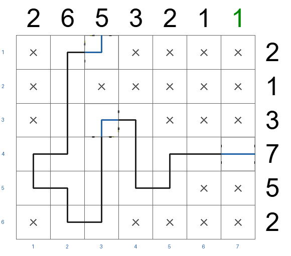

# Counts SFT: independent validation rollout

- [Modal evaluation run](https://modal.com/apps/zuhairsannnnn/main/ap-d7cmLQDOSTuwsTJ7S6pjrk)
- Checkpoint: `d1-2b-counts-full-train-tracks-decisions-20261111T035117Z`
- Dataset revision: `bfddb2300d31281c305c13b72432c081f33b72c6`
- [Raw 46-puzzle report](../results/validation-counts-sft-d1-2b-counts-full-train-tracks-decisions-20261111T035117Z-20261111T062829Z.json)
- [Recreate the visual gallery](GALLERIES.md)

## Results

| Measure | Plain SFT | Counts SFT |
| --- | ---: | ---: |
| Whole puzzles solved | 0/46 | **3/46 (6.5%)** |
| Correct cells | 1,269/2,472 (51.3%) | **1,511/2,472 (61.1%)** |
| Exact track shapes | 168/1,067 (15.7%) | **333/1,067 (31.2%)** |
| Malformed answers | 0 | 0 |
| Mean absolute row clue error | 1.75 | **0.43** |
| Mean absolute column clue error | 1.84 | **0.42** |
| Median step of first wrong move | 4 | **8** |

The three solved puzzles are `19022026-small` (39/39),
`14072026-small` (38/38), and `17082026-small` (38/38).

Four puzzles matched every row and column clue. Three of those were exact
solutions; `25022026-small` matched the clue totals but had only 29/51 cells
correct. This shows that counts alone do not enforce track connectivity and
shape. The most common first error was choosing `empty` where an `SE` track
belonged (20 puzzles).

A local connection audit found 42/46 counts SFT boards with broken neighboring
ports (253 unmatched ports in total), versus 29/46 boards and 60 unmatched ports
for plain SFT. In `25022026-small`, 12 ports were unmatched and the reciprocal
track graph had seven components. `modal/tools/analyze_topology.py` reproduces these
counts. Only 7 of 46 first errors directly contradicted ports already known at
that step, so local port cues will not resolve every early ambiguity.

## Method and limit

The model completed each puzzle in row-major order using its own earlier moves.
All seven choices were available. The executor supplied the source row and
column clues plus arithmetic counts of occupied, unassigned, and remaining
cells; it did not filter, correct, or search over answers. Exact match to the
audited unique solution was checked only after the final move. Evaluation took
91.6 seconds summed over puzzles, excluding model and dataset loading.

These are validation results used to choose experiments. The held-out test
splits remain untouched. The counts input also includes visual focus outlines,
so this comparison does not isolate arithmetic counts from visual focus.
