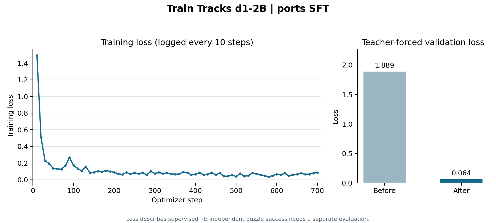
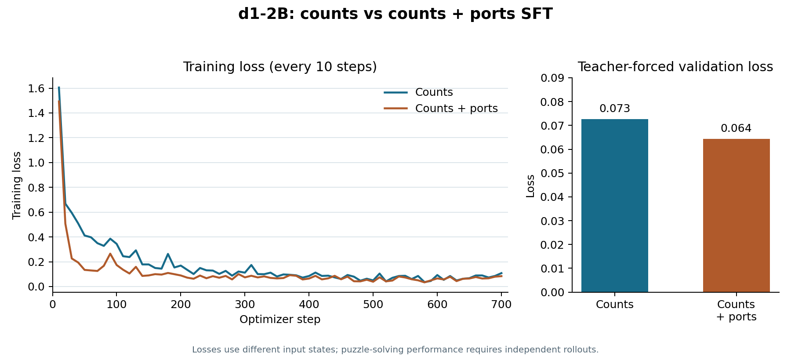

# Ports SFT: full training run

**Run:** [`d1-2b-ports-full-train-tracks-decisions-20261111T070304Z`](https://modal.com/apps/zuhairsannnnn/main/ap-lL6EdMTERYDOiQdWdw2QfL)  
**Status:** completed; checkpoint saved in the Modal Volume.



## Comparison with counts SFT



| Measure | [Counts SFT](COUNTS_FULL_TRAINING.md) | Ports SFT |
| --- | ---: | ---: |
| Training decisions | 11,187 | 11,187 |
| Validation decisions | 2,472 | 2,472 |
| Optimizer steps | 700 | 700 |
| Training time | 29.6 min | 31.3 min |
| Peak allocated GPU memory | 5.84 GiB | 5.91 GiB |
| Mean training loss | 0.1719 | 0.1123 |
| Teacher-forced validation loss, before | 2.0739 | 1.8885 |
| Teacher-forced validation loss, after | 0.0727 | 0.0644 |

Both runs used `LiquidAI/d1-2B` revision `97c57047d5852d77e02dfac211f8768aff77a8b2` and dataset
`zuhairsan/train-tracks-decisions` revision `bfddb2300d31281c305c13b72432c081f33b72c6`. Each used one epoch,
LoRA rank 16 / alpha 32 / dropout 0.05, learning rate 2e-4, batch size 2 with
8 accumulation steps, and seed 42. The ports variant adds neighboring-port
status to the counts state. The different input states produce different loss
scales; a lower supervised loss does **not** establish better whole-puzzle
solving. Run an independent 46-puzzle validation rollout before selecting a
checkpoint. The held-out test splits remain untouched.

The checkpoint is at `/mnt/train-tracks-d1-training/runs/d1-2b-ports-full-train-tracks-decisions-20261111T070304Z` in the Modal Volume.

[Ports loss CSV](../training-logs/ports-full-sft-loss.csv)

## Full ports training log

```text
Training LiquidAI/d1-2B: d1-2b-ports-full-train-tracks-decisions-20261111T070304Z
{'loss': '1.493', 'grad_norm': '2.58', 'learning_rate': '5.143e-05', 'entropy': '4.276', 'mean_token_accuracy': '0.6813', 'num_tokens': '2.44e+05', 'epoch': '0.0143'}
{'loss': '0.5069', 'grad_norm': '4.913', 'learning_rate': '0.0001086', 'entropy': '0.6847', 'mean_token_accuracy': '0.8219', 'num_tokens': '4.828e+05', 'epoch': '0.0286'}
{'loss': '0.2263', 'grad_norm': '2.826', 'learning_rate': '0.0001657', 'entropy': '0.222', 'mean_token_accuracy': '0.9062', 'num_tokens': '7.257e+05', 'epoch': '0.0429'}
{'loss': '0.1939', 'grad_norm': '0.7129', 'learning_rate': '0.0002', 'entropy': '0.1837', 'mean_token_accuracy': '0.9219', 'num_tokens': '9.719e+05', 'epoch': '0.0572'}
{'loss': '0.1343', 'grad_norm': '0.608', 'learning_rate': '0.0001998', 'entropy': '0.1362', 'mean_token_accuracy': '0.9313', 'num_tokens': '1.218e+06', 'epoch': '0.07151'}
{'loss': '0.1297', 'grad_norm': '0.5531', 'learning_rate': '0.0001994', 'entropy': '0.1492', 'mean_token_accuracy': '0.9375', 'num_tokens': '1.465e+06', 'epoch': '0.08581'}
{'loss': '0.1256', 'grad_norm': '2.092', 'learning_rate': '0.0001987', 'entropy': '0.1145', 'mean_token_accuracy': '0.9375', 'num_tokens': '1.714e+06', 'epoch': '0.1001'}
{'loss': '0.1673', 'grad_norm': '0.3093', 'learning_rate': '0.0001978', 'entropy': '0.1525', 'mean_token_accuracy': '0.9125', 'num_tokens': '1.958e+06', 'epoch': '0.1144'}
{'loss': '0.2652', 'grad_norm': '0.6516', 'learning_rate': '0.0001968', 'entropy': '0.1957', 'mean_token_accuracy': '0.8969', 'num_tokens': '2.201e+06', 'epoch': '0.1287'}
{'loss': '0.1735', 'grad_norm': '1.489', 'learning_rate': '0.0001955', 'entropy': '0.1542', 'mean_token_accuracy': '0.9156', 'num_tokens': '2.445e+06', 'epoch': '0.143'}
{'loss': '0.1357', 'grad_norm': '0.8679', 'learning_rate': '0.000194', 'entropy': '0.1554', 'mean_token_accuracy': '0.925', 'num_tokens': '2.697e+06', 'epoch': '0.1573'}
{'loss': '0.1051', 'grad_norm': '1.286', 'learning_rate': '0.0001922', 'entropy': '0.1121', 'mean_token_accuracy': '0.95', 'num_tokens': '2.939e+06', 'epoch': '0.1716'}
{'loss': '0.1589', 'grad_norm': '0.3985', 'learning_rate': '0.0001903', 'entropy': '0.09592', 'mean_token_accuracy': '0.9469', 'num_tokens': '3.181e+06', 'epoch': '0.1859'}
{'loss': '0.08564', 'grad_norm': '0.3792', 'learning_rate': '0.0001882', 'entropy': '0.0956', 'mean_token_accuracy': '0.9563', 'num_tokens': '3.429e+06', 'epoch': '0.2002'}
{'loss': '0.08968', 'grad_norm': '0.6908', 'learning_rate': '0.0001858', 'entropy': '0.07773', 'mean_token_accuracy': '0.95', 'num_tokens': '3.675e+06', 'epoch': '0.2145'}
{'loss': '0.09995', 'grad_norm': '0.4229', 'learning_rate': '0.0001833', 'entropy': '0.08919', 'mean_token_accuracy': '0.9531', 'num_tokens': '3.926e+06', 'epoch': '0.2288'}
{'loss': '0.09634', 'grad_norm': '0.5831', 'learning_rate': '0.0001806', 'entropy': '0.09669', 'mean_token_accuracy': '0.95', 'num_tokens': '4.166e+06', 'epoch': '0.2431'}
{'loss': '0.1096', 'grad_norm': '0.462', 'learning_rate': '0.0001777', 'entropy': '0.1142', 'mean_token_accuracy': '0.9437', 'num_tokens': '4.406e+06', 'epoch': '0.2574'}
{'loss': '0.09963', 'grad_norm': '0.1331', 'learning_rate': '0.0001747', 'entropy': '0.07233', 'mean_token_accuracy': '0.9344', 'num_tokens': '4.643e+06', 'epoch': '0.2717'}
{'loss': '0.08934', 'grad_norm': '0.4356', 'learning_rate': '0.0001715', 'entropy': '0.1061', 'mean_token_accuracy': '0.9625', 'num_tokens': '4.893e+06', 'epoch': '0.286'}
{'loss': '0.07185', 'grad_norm': '0.5684', 'learning_rate': '0.0001681', 'entropy': '0.07541', 'mean_token_accuracy': '0.9656', 'num_tokens': '5.131e+06', 'epoch': '0.3003'}
{'loss': '0.06287', 'grad_norm': '1.402', 'learning_rate': '0.0001645', 'entropy': '0.06549', 'mean_token_accuracy': '0.9594', 'num_tokens': '5.376e+06', 'epoch': '0.3146'}
{'loss': '0.08868', 'grad_norm': '0.3182', 'learning_rate': '0.0001609', 'entropy': '0.07302', 'mean_token_accuracy': '0.9469', 'num_tokens': '5.623e+06', 'epoch': '0.3289'}
{'loss': '0.06695', 'grad_norm': '0.33', 'learning_rate': '0.000157', 'entropy': '0.07589', 'mean_token_accuracy': '0.9656', 'num_tokens': '5.859e+06', 'epoch': '0.3432'}
{'loss': '0.08356', 'grad_norm': '0.3166', 'learning_rate': '0.0001531', 'entropy': '0.07727', 'mean_token_accuracy': '0.9594', 'num_tokens': '6.101e+06', 'epoch': '0.3575'}
{'loss': '0.07103', 'grad_norm': '1.168', 'learning_rate': '0.000149', 'entropy': '0.06885', 'mean_token_accuracy': '0.975', 'num_tokens': '6.349e+06', 'epoch': '0.3718'}
{'loss': '0.0856', 'grad_norm': '0.4989', 'learning_rate': '0.0001449', 'entropy': '0.08773', 'mean_token_accuracy': '0.9563', 'num_tokens': '6.595e+06', 'epoch': '0.3861'}
{'loss': '0.05746', 'grad_norm': '0.1386', 'learning_rate': '0.0001406', 'entropy': '0.08241', 'mean_token_accuracy': '0.975', 'num_tokens': '6.836e+06', 'epoch': '0.4004'}
{'loss': '0.1005', 'grad_norm': '1.451', 'learning_rate': '0.0001362', 'entropy': '0.08798', 'mean_token_accuracy': '0.9406', 'num_tokens': '7.083e+06', 'epoch': '0.4147'}
{'loss': '0.07407', 'grad_norm': '0.3096', 'learning_rate': '0.0001318', 'entropy': '0.07652', 'mean_token_accuracy': '0.9469', 'num_tokens': '7.321e+06', 'epoch': '0.429'}
{'loss': '0.08686', 'grad_norm': '0.3635', 'learning_rate': '0.0001273', 'entropy': '0.08589', 'mean_token_accuracy': '0.9531', 'num_tokens': '7.562e+06', 'epoch': '0.4433'}
{'loss': '0.07362', 'grad_norm': '0.4307', 'learning_rate': '0.0001227', 'entropy': '0.07542', 'mean_token_accuracy': '0.9625', 'num_tokens': '7.813e+06', 'epoch': '0.4576'}
{'loss': '0.08208', 'grad_norm': '0.3424', 'learning_rate': '0.0001181', 'entropy': '0.08511', 'mean_token_accuracy': '0.9625', 'num_tokens': '8.057e+06', 'epoch': '0.4719'}
{'loss': '0.0696', 'grad_norm': '0.497', 'learning_rate': '0.0001134', 'entropy': '0.08271', 'mean_token_accuracy': '0.9688', 'num_tokens': '8.291e+06', 'epoch': '0.4862'}
{'loss': '0.06567', 'grad_norm': '0.15', 'learning_rate': '0.0001087', 'entropy': '0.04336', 'mean_token_accuracy': '0.9812', 'num_tokens': '8.532e+06', 'epoch': '0.5005'}
{'loss': '0.06836', 'grad_norm': '1.664', 'learning_rate': '0.000104', 'entropy': '0.05574', 'mean_token_accuracy': '0.9688', 'num_tokens': '8.781e+06', 'epoch': '0.5148'}
{'loss': '0.09181', 'grad_norm': '0.4007', 'learning_rate': '9.929e-05', 'entropy': '0.07095', 'mean_token_accuracy': '0.95', 'num_tokens': '9.03e+06', 'epoch': '0.5291'}
{'loss': '0.08667', 'grad_norm': '0.4902', 'learning_rate': '9.457e-05', 'entropy': '0.08985', 'mean_token_accuracy': '0.9469', 'num_tokens': '9.28e+06', 'epoch': '0.5434'}
{'loss': '0.05712', 'grad_norm': '0.3204', 'learning_rate': '8.986e-05', 'entropy': '0.06913', 'mean_token_accuracy': '0.9688', 'num_tokens': '9.525e+06', 'epoch': '0.5577'}
{'loss': '0.06453', 'grad_norm': '0.1252', 'learning_rate': '8.517e-05', 'entropy': '0.06961', 'mean_token_accuracy': '0.9688', 'num_tokens': '9.769e+06', 'epoch': '0.572'}
{'loss': '0.08631', 'grad_norm': '0.4855', 'learning_rate': '8.052e-05', 'entropy': '0.08683', 'mean_token_accuracy': '0.95', 'num_tokens': '1.001e+07', 'epoch': '0.5863'}
{'loss': '0.05789', 'grad_norm': '0.1093', 'learning_rate': '7.591e-05', 'entropy': '0.05615', 'mean_token_accuracy': '0.9594', 'num_tokens': '1.026e+07', 'epoch': '0.6006'}
{'loss': '0.06629', 'grad_norm': '0.3775', 'learning_rate': '7.135e-05', 'entropy': '0.0754', 'mean_token_accuracy': '0.9594', 'num_tokens': '1.049e+07', 'epoch': '0.6149'}
{'loss': '0.08639', 'grad_norm': '0.2215', 'learning_rate': '6.686e-05', 'entropy': '0.06638', 'mean_token_accuracy': '0.9594', 'num_tokens': '1.074e+07', 'epoch': '0.6292'}
{'loss': '0.05857', 'grad_norm': '0.1826', 'learning_rate': '6.244e-05', 'entropy': '0.05898', 'mean_token_accuracy': '0.9625', 'num_tokens': '1.099e+07', 'epoch': '0.6435'}
{'loss': '0.08007', 'grad_norm': '0.3975', 'learning_rate': '5.811e-05', 'entropy': '0.07943', 'mean_token_accuracy': '0.9688', 'num_tokens': '1.124e+07', 'epoch': '0.6578'}
{'loss': '0.04267', 'grad_norm': '0.2683', 'learning_rate': '5.387e-05', 'entropy': '0.05814', 'mean_token_accuracy': '0.9844', 'num_tokens': '1.15e+07', 'epoch': '0.6721'}
{'loss': '0.04173', 'grad_norm': '0.3619', 'learning_rate': '4.973e-05', 'entropy': '0.05706', 'mean_token_accuracy': '0.9812', 'num_tokens': '1.174e+07', 'epoch': '0.6864'}
{'loss': '0.05494', 'grad_norm': '0.1637', 'learning_rate': '4.57e-05', 'entropy': '0.04982', 'mean_token_accuracy': '0.9781', 'num_tokens': '1.198e+07', 'epoch': '0.7008'}
{'loss': '0.03888', 'grad_norm': '0.06877', 'learning_rate': '4.18e-05', 'entropy': '0.03333', 'mean_token_accuracy': '0.9844', 'num_tokens': '1.222e+07', 'epoch': '0.7151'}
{'loss': '0.07463', 'grad_norm': '0.4093', 'learning_rate': '3.802e-05', 'entropy': '0.06375', 'mean_token_accuracy': '0.9656', 'num_tokens': '1.246e+07', 'epoch': '0.7294'}
{'loss': '0.04182', 'grad_norm': '0.2984', 'learning_rate': '3.438e-05', 'entropy': '0.04253', 'mean_token_accuracy': '0.9812', 'num_tokens': '1.27e+07', 'epoch': '0.7437'}
{'loss': '0.04846', 'grad_norm': '0.3236', 'learning_rate': '3.089e-05', 'entropy': '0.06196', 'mean_token_accuracy': '0.9781', 'num_tokens': '1.295e+07', 'epoch': '0.758'}
{'loss': '0.08127', 'grad_norm': '1.018', 'learning_rate': '2.756e-05', 'entropy': '0.04791', 'mean_token_accuracy': '0.9781', 'num_tokens': '1.319e+07', 'epoch': '0.7723'}
{'loss': '0.07293', 'grad_norm': '0.142', 'learning_rate': '2.438e-05', 'entropy': '0.0525', 'mean_token_accuracy': '0.9656', 'num_tokens': '1.343e+07', 'epoch': '0.7866'}
{'loss': '0.05877', 'grad_norm': '0.3046', 'learning_rate': '2.138e-05', 'entropy': '0.05943', 'mean_token_accuracy': '0.9656', 'num_tokens': '1.368e+07', 'epoch': '0.8009'}
{'loss': '0.05028', 'grad_norm': '0.004448', 'learning_rate': '1.855e-05', 'entropy': '0.06262', 'mean_token_accuracy': '0.975', 'num_tokens': '1.392e+07', 'epoch': '0.8152'}
{'loss': '0.03375', 'grad_norm': '0.2015', 'learning_rate': '1.59e-05', 'entropy': '0.04475', 'mean_token_accuracy': '0.9781', 'num_tokens': '1.418e+07', 'epoch': '0.8295'}
{'loss': '0.04965', 'grad_norm': '0.1898', 'learning_rate': '1.344e-05', 'entropy': '0.056', 'mean_token_accuracy': '0.975', 'num_tokens': '1.441e+07', 'epoch': '0.8438'}
{'loss': '0.0656', 'grad_norm': '0.3058', 'learning_rate': '1.117e-05', 'entropy': '0.0696', 'mean_token_accuracy': '0.9719', 'num_tokens': '1.466e+07', 'epoch': '0.8581'}
{'loss': '0.05711', 'grad_norm': '4.521e-05', 'learning_rate': '9.099e-06', 'entropy': '0.04948', 'mean_token_accuracy': '0.9656', 'num_tokens': '1.491e+07', 'epoch': '0.8724'}
{'loss': '0.07882', 'grad_norm': '0.4442', 'learning_rate': '7.233e-06', 'entropy': '0.08362', 'mean_token_accuracy': '0.9656', 'num_tokens': '1.514e+07', 'epoch': '0.8867'}
{'loss': '0.04398', 'grad_norm': '0.2235', 'learning_rate': '5.573e-06', 'entropy': '0.05122', 'mean_token_accuracy': '0.9812', 'num_tokens': '1.539e+07', 'epoch': '0.901'}
{'loss': '0.06257', 'grad_norm': '0.1229', 'learning_rate': '4.124e-06', 'entropy': '0.07151', 'mean_token_accuracy': '0.975', 'num_tokens': '1.562e+07', 'epoch': '0.9153'}
{'loss': '0.06476', 'grad_norm': '0.2421', 'learning_rate': '2.888e-06', 'entropy': '0.06729', 'mean_token_accuracy': '0.975', 'num_tokens': '1.587e+07', 'epoch': '0.9296'}
{'loss': '0.07679', 'grad_norm': '0.2123', 'learning_rate': '1.87e-06', 'entropy': '0.08138', 'mean_token_accuracy': '0.9531', 'num_tokens': '1.611e+07', 'epoch': '0.9439'}
{'loss': '0.06476', 'grad_norm': '0.2321', 'learning_rate': '1.07e-06', 'entropy': '0.07568', 'mean_token_accuracy': '0.9625', 'num_tokens': '1.636e+07', 'epoch': '0.9582'}
{'loss': '0.06654', 'grad_norm': '0.562', 'learning_rate': '4.917e-07', 'entropy': '0.06518', 'mean_token_accuracy': '0.9688', 'num_tokens': '1.66e+07', 'epoch': '0.9725'}
{'loss': '0.07955', 'grad_norm': '0.399', 'learning_rate': '1.35e-07', 'entropy': '0.07584', 'mean_token_accuracy': '0.9563', 'num_tokens': '1.683e+07', 'epoch': '0.9868'}
{'loss': '0.08384', 'grad_norm': '0.01044', 'learning_rate': '1.116e-09', 'entropy': '0.07975', 'mean_token_accuracy': '0.9527', 'num_tokens': '1.706e+07', 'epoch': '1'}
{'train_runtime': '1880', 'train_samples_per_second': '5.951', 'train_steps_per_second': '0.372', 'train_loss': '0.1123', 'epoch': '1'}
{
  "run_id": "d1-2b-ports-full-train-tracks-decisions-20261111T070304Z",
  "mode": "full",
  "visual_variant": "ports",
  "label_source": "dataset.label",
  "dataset": "zuhairsan/train-tracks-decisions",
  "dataset_revision": "bfddb2300d31281c305c13b72432c081f33b72c6",
  "model": "LiquidAI/d1-2B",
  "model_revision": "97c57047d5852d77e02dfac211f8768aff77a8b2",
  "validation_split": "validation",
  "optimizer_steps": 700,
  "trainable_parameters": 16468736,
  "train_runtime_seconds": 1879.706,
  "peak_gpu_memory_gib": 5.909875392913818,
  "train_rows": 11187,
  "validation_rows": 2472,
  "validation_loss_before": 1.8885143995285034,
  "validation_loss_after": 0.06438463181257248,
  "output_dir": "/mnt/train-tracks-d1-training/runs/d1-2b-ports-full-train-tracks-decisions-20261111T070304Z"
}
```
