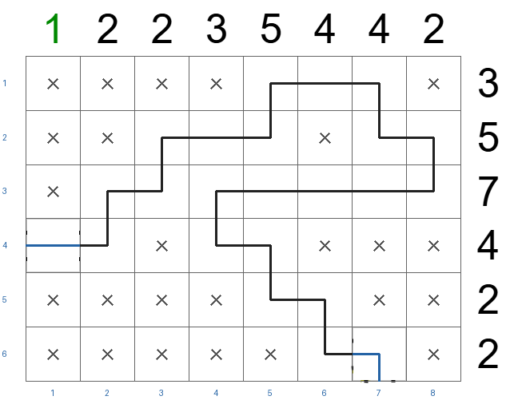

# Ports SFT: independent validation rollout

- [Modal evaluation run](https://modal.com/apps/zuhairsannnnn/main/ap-4OpoGnPvQWO30rmCtoV7Xs)
- Checkpoint: `d1-2b-ports-full-train-tracks-decisions-20261111T070304Z`
- Dataset revision: `bfddb2300d31281c305c13b72432c081f33b72c6`
- [Raw 46-puzzle report](../results/validation-ports-sft-d1-2b-ports-full-train-tracks-decisions-20261111T070304Z-20261111T081833Z.json)
- [Recreate the predicted versus verified HTML gallery](GALLERIES.md)

## Results

| Measure | [Counts SFT](COUNTS_VALIDATION.md) | Ports SFT |
| --- | ---: | ---: |
| Whole puzzles solved | 3/46 (6.5%) | **4/46 (8.7%)** |
| Correct cells | **1,511/2,472 (61.1%)** | 1,401/2,472 (56.7%) |
| Exact track shapes | 333/1,067 (31.2%) | **372/1,067 (34.9%)** |
| Malformed answers | 0 | 0 |
| Mean absolute row clue error | **0.43** | 0.72 |
| Mean absolute column clue error | **0.42** | 0.76 |
| Boards with broken ports | 42/46 | **25/46** |
| Total unmatched ports | 253 | **50** |
| Median step of first wrong move | 8 | 8 |

The four solved puzzles are
`19022026-small` (39/39), `09062026-small` (46/46),
`22072026-small` (46/46), and `17082026-small` (38/38).
Two are new relative to counts SFT; counts SFT solved `14072026-small`,
which ports SFT did not solve.

| Predicted board: 09062026-small | Verified solution |
| --- | --- |
|  |  |

## Interpretation

Port status improved local track agreement: no puzzle's first wrong move
contradicted a port already known at that moment, versus seven such first
mistakes for counts SFT. It also predicted track in 1,157 cells, above the
1,067 true track cells, while counts SFT predicted 919. This helps track recall
but raises false positives and worsens clue-count errors. The small 4-versus-3
whole-puzzle difference is not enough to establish a reliable advantage.

At the first wrong decision in each of the 42 unsolved ports rollouts, another
unassigned cell elsewhere on the board already had forced occupancy from the
visible counts or ports. In 26 of those 42 boards, another cell's exact tile
was forced. The median was 10 other occupancy-forced cells and four other
exact-tile cells. Only two current targets had count-forced occupancy, and no
first wrong choice contradicted a known count or port. This supports testing
adaptive cell order before adding more rule text. `modal/tools/diagnose_rollouts.py`
reproduces the audit from saved reports and source clues.

The model chose every tile from all seven options in row-major order, using its
own earlier moves. The executor supplied counts and neighboring-port status
from source givens and prior model actions but did not filter or correct
choices. Exact match to the audited unique solution was scored after the final
move. The held-out test splits remain untouched.
